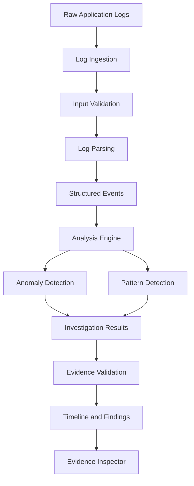
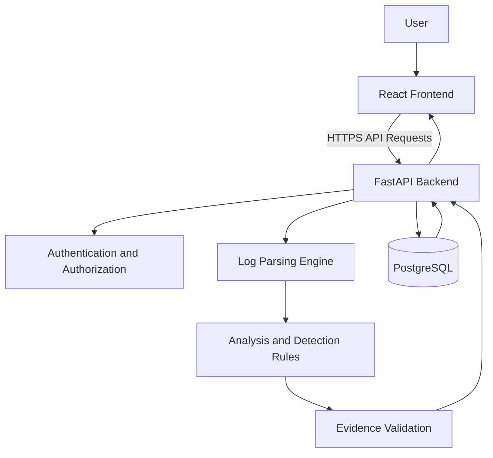

# TraceGuard AI

### Evidence-Driven Application Incident Investigation

TraceGuard AI is an incident investigation workspace designed to help developers understand application failures faster by transforming raw application logs into structured events, timelines, detected patterns, and evidence-linked findings.

Instead of simply generating an AI explanation, TraceGuard separates **observed facts, detected patterns, and unconfirmed hypotheses** so developers can investigate incidents with greater clarity and traceability.

**Live Application:** https://trace-gaurd-ai.vercel.app/

**Backend API:** https://traceguard-backend-k7o5.onrender.com

---

## Table of Contents

- [Overview](#overview)
- [Problem Statement](#problem-statement)
- [Our Approach](#our-approach)
- [Key Features](#key-features)
- [How It Works](#how-it-works)
- [Supported Log Formats](#supported-log-formats)
- [System Architecture](#system-architecture)
- [Technology Stack](#technology-stack)
- [Security](#security)
- [Getting Started](#getting-started)
- [Environment Configuration](#environment-configuration)
- [Running with Docker](#running-with-docker)
- [Testing](#testing)
- [Deployment](#deployment)
- [Project Structure](#project-structure)
- [Limitations](#limitations)
- [Contributing](#contributing)
- [License](#license)

---

## Overview

Modern applications generate large volumes of logs. When an incident occurs, developers often need to inspect thousands of lines to identify what happened, which events are related, and what might have caused the failure.

TraceGuard AI helps organize this investigation process.

Users can upload or paste application logs and receive a structured investigation containing:

- A chronological event timeline.
- Error and anomaly detection.
- Repeated failure identification.
- Retry and failure-chain patterns.
- Evidence-linked findings.
- Clearly separated facts and hypotheses.

The goal is to make incident investigation more understandable, traceable, and efficient.

## Problem Statement

Traditional log investigation can be time-consuming and difficult, especially when:

- Logs contain thousands of lines.
- Multiple errors occur close together.
- A single incident produces several related failures.
- Stack traces span multiple lines.
- Developers cannot easily distinguish root causes from symptoms.
- Automated explanations provide conclusions without showing supporting evidence.

A useful investigation system should not only explain what might have happened. It should also show the evidence behind each finding.

## Our Approach

TraceGuard AI follows an evidence-first investigation approach.

It organizes investigation results into three categories:

| Category | Meaning |
|---|---|
| Observed Facts | Information directly present in the logs. |
| Detected Patterns | Repeated errors, spikes, retries, or relationships identified by analysis rules. |
| Unconfirmed Hypotheses | Possible explanations that require further investigation. |

Every evidence-linked finding should reference the relevant source log lines, allowing developers to inspect the original evidence rather than blindly trusting an automated explanation.

## Key Features

### 1. Log Ingestion

- Paste logs directly into the application.
- Upload supported log files.
- Validate and process incoming data.
- Enforce a maximum upload size of 5 MB.

### 2. Structured Event Timeline

Convert raw log entries into structured events and arrange them chronologically.

This helps developers understand the sequence of events leading up to an incident.

### 3. Anomaly Detection

Identify potentially important patterns, including:

- Error spikes.
- Repeated failures.
- Retry storms.
- Failure chains.
- Unusual event concentrations.

### 4. Evidence-Linked Findings

Investigation findings reference source line numbers.

Developers can inspect the original log entries associated with a detected pattern or hypothesis.

### 5. Investigation Workspace

The interface is organized around three primary areas:

- **Timeline:** Chronological view of application events.
- **Findings:** Observed facts, detected patterns, and hypotheses.
- **Evidence Inspector:** Original log lines supporting investigation findings.

### 6. Optional LLM Analysis

TraceGuard AI supports an optional LLM-assisted analysis mode when an appropriate API key is configured.

The system is designed to validate evidence references rather than treating generated explanations as automatically verified facts.

### 7. Authentication and Incident Management

The application includes:

- User registration and authentication.
- JWT-based authentication.
- HTTP-only cookie support.
- Organization-aware incident access.
- Protected incident management endpoints.

---

## How It Works

The investigation workflow follows these stages:

1. **Input:** The user uploads or pastes application logs.
2. **Validation:** The backend validates the input and applies file-size restrictions.
3. **Parsing:** Raw log entries are converted into structured events.
4. **Analysis:** Deterministic rules inspect events for anomalies and recurring patterns.
5. **Investigation:** Findings are organized into facts, patterns, and hypotheses.
6. **Evidence Linking:** Findings are associated with their supporting source line numbers.
7. **Presentation:** The frontend displays the timeline, findings, and evidence inspector.



## Supported Log Formats

The project is designed to support the following input types:

| Format | Description |
|---|---|
| JSON Application Logs | Structured application log entries. |
| Python Stack Traces | Multiline Python exception traces. |
| Java Stack Traces | Multiline Java exception traces. |
| Nginx Access Logs | Nginx combined access log format. |
| Apache Access Logs | Apache combined access log format. |

Actual parsing support depends on the implemented parser and validation rules in the backend.

---

## System Architecture

TraceGuard AI uses a frontend-backend architecture.



### Frontend

The frontend provides the investigation interface, authentication experience, and communication with the backend API.

### Backend

The FastAPI backend handles:

- API requests.
- Authentication and authorization.
- Log validation and parsing.
- Analysis execution.
- Incident management.
- Evidence-linked investigation results.

### Database

PostgreSQL stores application data and supports persistent incident and user-related workflows.

---

## Technology Stack

| Layer | Technologies |
|---|---|
| Frontend | React, TypeScript, Vite |
| Backend | Python, FastAPI |
| Database | PostgreSQL |
| Authentication | JWT, HTTP-only Cookies |
| Data Validation | Pydantic |
| Analysis | Python-based deterministic detection rules |
| Containerization | Docker, Docker Compose |
| Frontend Deployment | Vercel |
| Backend Deployment | Render |
| Version Control | Git, GitHub |
| Testing | Pytest, Oxlint |

---

## Security

Security is an important part of TraceGuard AI's development.

Implemented security measures include:

- Production secret validation.
- Environment-based configuration.
- Restricted CORS origins.
- JWT-based authentication.
- HTTP-only authentication cookies.
- Password hashing using Argon2id.
- Organization-aware incident authorization.
- Request and upload validation.
- Bounded incident listing queries.
- Production database health-response sanitization.
- Frontend security headers and Content Security Policy.
- Restricted database networking in the production Docker Compose configuration.

### Important Security Notes

- Never commit real API keys, passwords, database credentials, or signing secrets.
- Keep production secrets in the deployment platform's environment configuration.
- Use HTTPS for production communication.
- Review access permissions and database backups regularly.
- Security controls should be tested continuously.

No application can guarantee complete protection against every security vulnerability.

---

## Getting Started

### Prerequisites

Install the following tools:

- Python 3.11 or compatible version.
- Node.js and npm.
- PostgreSQL.
- Git.
- Docker and Docker Compose (optional, for containerized setup).

### 1. Clone the Repository

```bash
git clone https://github.com/EshemWaseem/TraceGaurd_AI.git

cd TraceGaurd_AI
```

### 2. Backend Setup

Navigate to the backend directory:

```bash
cd backend
```

Create a virtual environment:

```bash
python -m venv .venv
```

Activate it on Windows:

```powershell
.venv\Scripts\activate
```

Activate it on Linux or macOS:

```bash
source .venv/bin/activate
```

Install dependencies:

```bash
pip install -r requirements.txt
```

Configure the required backend environment variables using the project's environment example and configuration.

Start the backend:

```bash
uvicorn app.main:app --reload --host 127.0.0.1 --port 8010
```

The backend will be available at:

```text
http://127.0.0.1:8010
```

Interactive API documentation may be available during local development, depending on the application configuration.

### 3. Frontend Setup

Open another terminal and navigate to the frontend:

```bash
cd frontend
```

Install dependencies:

```bash
npm install
```

Configure the frontend environment variables according to the project's environment example.

Start the development server:

```bash
npm run dev
```

Vite will display the local frontend URL in your terminal.

---

## Environment Configuration

The application uses environment variables for configuration.

Create local environment files based on the provided examples:

```text
.env.example
```

Typical backend configuration includes:

| Variable | Purpose |
|---|---|
| `ENVIRONMENT` | Application environment. |
| `SECRET_KEY` | Secret used for signing authentication tokens. |
| `DATABASE_URL` | PostgreSQL connection string. |
| `COOKIE_SECURE` | Controls secure cookie behavior. |
| `COOKIE_SAMESITE` | Controls cookie SameSite behavior. |
| `ENABLE_PUBLIC_DOCS` | Controls public API documentation availability. |

The frontend may require an API base URL, depending on its current configuration.

**Important:**

- Use strong, randomly generated secrets in production.
- Never use example credentials in production.
- Do not commit `.env` files.
- Do not expose private credentials through frontend variables.
- Check the actual environment example files for the complete list of required settings.

---

## Running with Docker

The repository includes Docker-related configuration for containerized development and deployment.

Before running the production Compose configuration, provide all required environment variables.

For example, in PowerShell:

```powershell
$env:POSTGRES_USER="your_database_user"
$env:POSTGRES_PASSWORD="your_secure_database_password"
$env:POSTGRES_DB="your_database_name"
$env:SECRET_KEY="your_secure_random_secret"
```

Validate the production Compose configuration:

```bash
docker compose -f compose.prod.yaml config --quiet
```

Start the configured services:

```bash
docker compose -f compose.prod.yaml up -d --build
```

Check service status:

```bash
docker compose -f compose.prod.yaml ps
```

View logs:

```bash
docker compose -f compose.prod.yaml logs -f
```

Stop services:

```bash
docker compose -f compose.prod.yaml down
```

**Warning:** Do not use destructive volume-removal commands on a production deployment. Existing database data must be preserved.

---

## Testing

### Backend Tests

Run the backend test suite:

```bash
pytest -v --tb=short
```

Run a specific security test module:

```bash
pytest tests/test_production_security_audit_hardening.py -v
```

### Frontend Lint

```bash
npm run lint
```

### Frontend Production Build

```bash
npm run build
```

These checks help verify application behavior, code quality, and production build compatibility.

---

## Deployment

TraceGuard AI is deployed using the following services:

| Component | Platform |
|---|---|
| Frontend | Vercel |
| Backend | Render |
| Database | PostgreSQL deployment |

### Live URLs

- Frontend: https://trace-gaurd-ai.vercel.app/
- Backend: https://traceguard-backend-k7o5.onrender.com/

### Deployment Considerations

Before deploying changes:

1. Run backend tests.
2. Run frontend lint and production build.
3. Review the Git diff.
4. Verify environment variables.
5. Confirm database connectivity.
6. Deploy the backend and frontend.
7. Test the live application.
8. Keep a rollback path available.

Never commit production secrets or expose private deployment configuration.

---

## Project Structure

The repository is organized into frontend, backend, testing, and deployment-related components.

```text
TraceGaurd_AI/
│
├── backend/
│   ├── app/
│   │   ├── core/
│   │   ├── db/
│   │   ├── routers/
│   │   └── main.py
│   │
│   ├── tests/
│   ├── Dockerfile
│   └── requirements.txt
│
├── frontend/
│   ├── src/
│   ├── Dockerfile
│   └── vercel.json
│
├── compose.prod.yaml
├── .gitignore
├── .env.example
└── README.md
```

This is a high-level representation; additional files and modules may exist in the repository.

---

## Limitations

TraceGuard AI is an investigation assistant, not a replacement for experienced engineers or a complete observability platform.

- Detected patterns do not automatically prove root cause.
- Hypotheses require human verification.
- Results depend on the quality and completeness of input logs.
- Unsupported log formats may not be parsed correctly.
- Optional LLM-generated explanations may contain inaccuracies.
- Evidence references should always be checked against the original logs.

The application is intended to support investigation, not make unverified conclusions.

---

## Contributing

Contributions, bug reports, and suggestions are welcome.

To contribute:

1. Fork the repository.
2. Create a feature branch.
3. Implement and test your changes.
4. Review your changes for security and compatibility.
5. Submit a pull request with a clear description.

Please do not include credentials, private logs, or sensitive production data in issues or pull requests.

---

## License

No license has been specified here.

Please check the repository for an existing license before reusing, modifying, or distributing this project. If no license is present, the source code is not automatically granted an open-source reuse license.

---

## Project Information

**Project:** TraceGuard AI

**Category:** AI-Assisted Developer Tools / Incident Investigation

**Focus Areas:** Log Analysis, Anomaly Detection, Evidence-Based Investigation, Backend Engineering, Application Security

**Developer:** Eshem Waseem

**GitHub:** https://github.com/EshemWaseem/TraceGaurd_AI

**Live Application:** https://trace-gaurd-ai.vercel.app/

---

*TraceGuard AI — Turn raw application logs into structured, evidence-driven investigations.*